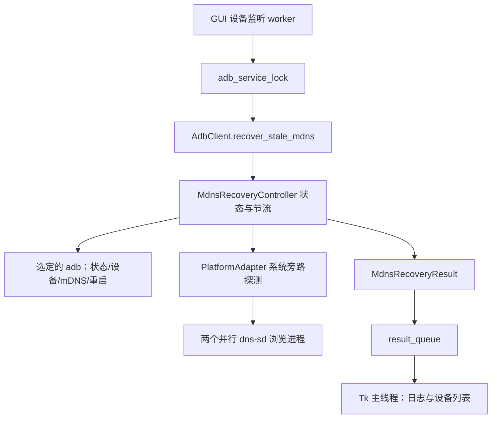

# ADB mDNS 异常自动恢复技术方案

- 状态：已实现；已复现启动超时，修复后的真机验收待执行
- 初稿：2026-08-14；实现修订：2026-10-23
- 适用项目：AdbPilot GUI；CLI / AI CLI 保持现有行为
- AI 状态机规范：[adb-mdns-auto-recovery-state-machine.json](adb-mdns-auto-recovery-state-machine.json)（状态、条件、转移、动作与不变量）
- 关联故障记录：[Android 无线调试一直显示“正在配对设备”](../../docs/troubleshooting/android-wireless-debugging-pairing-stuck.md)

## 1. 背景与边界

网络断开再恢复后，可能出现操作系统 Bonjour 能发现 `_adb-tls-pairing._tcp` / `_adb-tls-connect._tcp`，而 `adb mdns services` 持续为空的情况。重启当前 ADB Server 可以刷新其发现状态。

二维码服务名出现 `(2)`、`(3)` 等后缀只表示疑似重复实例，不能证明 Android Studio 的配对密钥或期望实例名。恢复服务发现不等于配对成功；手机侧重复实例仍需重开无线调试、生成新二维码或改用配对码处理。

本功能只自动修复具备旁路证据的 ADB 发现异常，不读取 Android Studio 私有日志、二维码密码或配对数据库，不主动连接陌生设备，不自动改变 ADB 环境变量。

## 2. 架构与接口



| 模块 | 已实现职责 |
| --- | --- |
| [mdns.py](../../adbpilot/mdns.py) | 不可变证据和结果类型、配置校验、六态状态机、检测间隔、二次确认、冷却和并发保护 |
| [platform_adapter.py](../../adbpilot/platform_adapter.py) | 查找 `dns-sd`，同时浏览两种 TLS 服务，按 Add/Rmv 及网卡维护有效证据，超时终止和回收进程 |
| [client.py](../../adbpilot/client.py) | ADB 短超时查询和自动恢复入口；沿用现有 `parse_devices` / `parse_mdns_services` |
| [gui.py](../../adbpilot/gui.py) | 每 3 秒设备监听、进程级控制器、查询/恢复/手动重启互斥、取消与队列展示 |

核心接口：

```python
PlatformAdapter.discover_system_adb_mdns_services(*, timeout=1.2) -> SystemMdnsDiscovery
PlatformAdapter.cancel_mdns_discovery() -> None
AdbClient.mdns_recovery_supported() -> bool
AdbClient.mdns_recovery_devices() -> tuple[Device, ...]
AdbClient.mdns_recovery_services() -> tuple[MdnsService, ...]
AdbClient.restart_current_server() -> None
AdbClient.recover_stale_mdns(*, controller=None, adapter=None,
                           cancelled=lambda: False, progress=None) -> MdnsRecoveryResult
MdnsRecoveryController.note_restart() -> None
```

原有 `mdns_services()` 继续返回字符串，原有扫码/配对调用者无需迁移。解析器补充支持含空格的实例名，例如 `studio-example (2)`。

GUI 持有控制器，切换 ADB 路径或超时设置后，新客户端仍共享冷却。直接调用客户端恢复入口也默认拥有可复用控制器；CLI 不自动调用恢复入口。

## 3. 自动重启的全部条件

1. `wireless_recovery.enabled` 开启，应用未退出，当前 ADB 客户端未被替换。
2. 本轮设备快照没有任何记录，包括 `device`、`offline`、`unauthorized`、`no permissions`。
3. 距上次探测达到 15 秒，距上次重启尝试结束达到 60 秒。
4. `adb server-status` 成功且明确返回 `mdns_enabled: true`。
5. 第一次 `adb mdns services` 无 TLS 服务。
6. 系统旁路探测成功，并发现至少一种本地 ADB TLS 服务。
7. 等待 0.3 秒后，第二次 ADB mDNS 查询仍无 TLS 服务。
8. 重启前重新读取设备列表，仍无任何设备记录，且取消条件仍未触发。

设备列表为空、手机 IP/端口变化、ADB 与系统都发现不到服务、实例名有数字后缀，均不能单独触发重启。查询异常也不视为空列表证据。

能力检测按项目现有无线兼容实现和 [Android 官方排障说明](https://developer.android.com/tools/adb) 使用 `server-status`，替换初稿中的 `mdns check`。后者不足以确认 mDNS 已启用。旧版 ADB 不支持 `server-status`、字段未知或显式关闭时返回 `unsupported`，保留手动操作。

## 4. 平台旁路探测

- macOS 优先从 PATH 查找 `dns-sd`，也支持 GUI 精简 PATH 下的 `/usr/bin/dns-sd`。
- Windows/Linux 只有存在兼容的 `dns-sd` 时启用；不安装额外依赖，没有命令则安全降级。
- 同时启动 `dns-sd -B <服务类型> local.` 两个浏览进程，共享一个探测截止时间。
- 按 `(interface, domain, service type, instance name)` 应用 Add/Rmv；一个网卡移除实例不抹掉另一个网卡的记录。仅接收 `local.` 下的两类 ADB TLS 服务。
- 浏览输出格式依据 [Apple dns-sd 实现](https://github.com/apple-oss-distributions/mDNSResponder/blob/main/Clients/dns-sd.c)。异常退出或错误事件使本轮旁路不可用，不使用部分成功结果触发重启。
- 默认浏览 1.2 秒。超时后 `terminate` 并 `communicate` 取回已收集输出；0.3 秒内未退出则 `kill`，继续有界回收。第二个进程使用剩余预算，避免串行等待两份完整超时。
- 进程注册与退出取消使用同一把锁，避免关闭应用时漏掉刚启动的子进程。worker 负责最终回收和关闭管道。

旁路浏览只需要服务存在证据，不额外解析 IP/端口。原始实例名只短暂用于 Add/Rmv 匹配，结果对象仅保留服务类型及疑似冲突布尔值。

## 5. 恢复顺序、超时和取消

```text
检查启用/取消/冷却/间隔
查询原始设备列表；非空则停止
查询 server-status；未明确启用 mDNS 则停止
第一次查询 ADB mDNS；有服务则停止
同时浏览两类系统服务；不支持或无证据则停止
等待确认间隔，再查 ADB mDNS；有服务则停止
重新查设备列表；非空则停止
再次检查取消
记录重启尝试时间
kill-server（允许非零退出码）
start-server（必须成功）
短暂稳定等待，检查取消
查询 ADB mDNS 和设备，返回验证结果
无论结果如何，更新尝试结束时间并进入完整冷却期
```

恢复命令按阶段设置独立的固定预算，不复用 GUI 的普通命令超时，也不修改原有手动 mDNS 查询的超时：

| 阶段 | 单命令超时 | 超时结果 |
| --- | --- | --- |
| `server-status`、`devices -l`、`mdns services` 查询 | 3 秒 | 重启前返回 `probe_failed`；重启完成后的验证查询返回 `restarted_unverified` |
| `kill-server` | 3 秒 | `restart_failed`，进入冷却，不执行启动 |
| `start-server` | 30 秒 | `restart_failed`，进入冷却，不立即重试 |

启动预算由 `ADB_SERVER_START_TIMEOUT_SECONDS` 单独定义。启动可能在 mDNS/TLS 初始化后才返回 ACK；2026-10-23 的真机日志显示，原 3 秒预算使启动客户端超时被终止，Server 随后写 ACK 报 `Broken pipe` 并退出，后续设备轮询又拉起了新的 Server。设备最终上线不能替代本轮恢复成功的判定。

`start-server` 在 30 秒内成功返回后，才设置 `restarted=True`、进入 `verifying` 并查询服务和设备；超过 3 秒但未超过启动预算的正常启动不再被判为失败。超过独立启动预算仍按真实失败处理，保持有界执行和冷却保护。

尝试开始前先记录重启标记，`finally` 在整次尝试结束时再次更新 `last_restart`，从完成/失败时刻计算完整冷却。启动与验证的耗时不抵扣冷却：即使配置最小 30 秒冷却，启动等到 30 秒超时后仍需再冷却 30 秒。手动重启同样从结束时刻进入冷却。

设备保护查询读取原始 transport 列表，不触发去重过程中的额外 `getprop` 查询。

自动恢复只重启当前客户端所连接的服务，不调用手动 `restart_server()` 中清理其他端口 ADB 的逻辑。`kill-server` 非零退出不阻止启动；命令异常或超时返回受控失败并冷却。

取消在关键步骤边界检查，正在执行的 ADB 命令最多等本条超时，启动阶段最长等待 30 秒。一旦进入 kill/start，不在两者之间中断启动，避免退出后只剩停止的服务。已完成重启后即使取消也保留 `restarted=True` 与冷却。

## 6. 结果、隐私与可观测性

`MdnsService` 只有 `service_type`、`address`、`name_conflict`。系统浏览不解析地址，`address` 为空；ADB 结果可带 IP:port，完整实例名不进入恢复结果。

`MdnsRecoveryResult` 包含 `status`、`restarted`、恢复前/后的 ADB 服务、系统服务、恢复后的设备快照；`message` 属性按受控状态生成固定提示。

| status | 含义 |
| --- | --- |
| `disabled` / `interval` / `cooldown` / `busy` / `cancelled` | 本轮未执行或停止；GUI 不重复输出 |
| `device_present` | 原始设备列表非空，保护当前连接 |
| `unsupported` | ADB 未明确启用 mDNS，或旁路不可用 |
| `not_needed` | ADB 服务已可见，包括二次查询时恢复 |
| `no_system_evidence` | 系统也无服务，属于正常无证据状态 |
| `probe_failed` | 重启前查询失败，不据此重启 |
| `recovered` | 重启后服务或设备恢复可见；不保证完成配对或授权 |
| `restarted_unverified` | kill/start 完成，但尚未观察到恢复，或验证查询失败 |
| `restart_failed` | 重启命令失败/超时；不立即重试 |
| `suspected_name_conflict` | ADB 发现带数字后缀的配对实例且没有设备上线时给出手机侧建议 |

名称后缀只有疑似提示意义，不能证明配对实例冲突。实例已可见时不重启。在线设备出现后优先按恢复可见处理。

GUI 用 `result_queue` 传递进度与结果，只有主线程写输出和设备列表。连续重复的警告仅显示一次；发生新的重启或结果变化后可以再次显示。异常原文可能含实例名或序列号，不展示在自动恢复日志中。恢复日志不包含二维码原文、密码、配对码、设备 GUID、完整序列号或 Wi-Fi 名称。

设备快照沿用已有 `Device` 结构供设备列表显示；序列号仅用于现有设备管理，不写入新增的恢复提示。此约束不改变原有连接历史模块的设备记录行为。

手动“重启 ADB 并重新检测”使用独立的 `MdnsRedetectionResult`：`status` 为 `checked`、`verification_failed`、`restart_failed` 或 `cancelled`，并保留 `restarted`、`devices` 和 `services`。两个快照中的 `None` 表示尚未取得结果，空元组才表示查询成功但为空；未知设备快照不能清空已有列表。`checked` 仅表示重启后完成查询，不承诺扫码配对成功。

## 7. GUI 调度与并发

- 设备监听仍为每 3 秒一轮；mDNS 深度探测独立节流到每 15 秒一次。
- `device_poll_running` 防止轮询 worker 重叠；控制器互斥锁防止恢复入口重入。
- 整轮查询/恢复在后台持有 `adb_service_lock`，与手动刷新、手动重启互斥，防止查询命令在 kill/start 间隙自动启动服务。只持锁覆盖本轮有界命令和两次短等待，不持锁等待下一次轮询或冷却。
- 轮询、手动刷新和重启入口只在 Tk 主线程捕获 ADB 路径/超时参数。客户端构造及路径发现（含 login-shell 探测）在后台线程执行；解析结果经队列回主线程后，确认参数未变且窗口未关闭才发布客户端并开始操作。缓存客户端匹配时直接复用。
- 并发解析相同设置时复用先发布的客户端；路径或超时变化后丢弃旧解析结果，不覆盖新选择。恢复 worker 不读取 Tk 变量。
- 切换客户端后，旧任务在命令边界取消；旧结果不提交到当前设备列表。关闭应用时设置取消事件，并终止系统浏览进程。
- 配置与时钟保存在 GUI 进程内，切换客户端不清空冷却；退出后不持久化状态。多个独立 GUI 进程之间不共享互斥和冷却。
- 设备可能在最后一次复查与 kill-server 之间上线；共享 ADB 没有原子“空设备时重启”接口，保护只能缩小竞态窗口，不能彻底消除其他进程引入的竞争。

### 7.1 在线设备保护提示与手动恢复

无线调试区和扫码弹窗共用一份保护提示，并都提供“重启 ADB 并重新检测”按钮。弹窗具有模态抓取，必须在弹窗内也能操作，不能只把入口放在主窗口。

- 自动恢复启用且有任何设备记录时，提示“已有设备记录，已跳过自动恢复，避免中断 USB/Wi-Fi 会话”，说明离线/未授权记录同样受保护。只有进入受保护状态时写一次提示日志，后续轮询不重复刷屏。
- 无设备记录时清除受保护提示，按原条件继续自动检测；自动恢复被配置关闭时显示关闭原因，但手动按钮仍可用。在线设备的存在不等于 mDNS 异常，提示不得宣称已诊断故障。
- 用户点击按钮后，明确确认重启会中断当前 USB/Wi-Fi 调试、安装和传输，并使旧二维码失效。取消确认不改变扫码任务，也不发起重启。
- 确认后取消旧扫码会话、递增会话代次并覆盖旧二维码。两个重启按钮及扫码入口在操作期间禁用，重复请求直接忽略；新配对/连接操作也不在此期间启动。
- 客户端仍在后台准备。后台 worker 在共享的 30 秒预算内等待所有尚未结束的旧扫码 worker（含先前重新生成二维码的会话）及其在途命令结束；超时只提示稍后重试，不操作 ADB、不进入重启冷却。旧会话的进度和结果按代次丢弃。
- 随后取得 `adb_service_lock`，再次检查应用关闭/客户端切换。只有用户确认的手动操作允许在设备列表非空时重启；自动路径的设备保护条件保持不变。执行 `restart_current_server()`，只重启当前客户端服务，不清理其他端口服务，停止/启动预算仍为 3/30 秒。
- 重启成功后重新查询设备和 ADB mDNS 服务（各 3 秒）；主线程更新已知的设备快照，在无线调试区和扫码弹窗同步反馈设备/服务数量，并建议按需重新生成二维码。检测失败与重启失败分开提示，保留已知快照，不把未知当作“无设备”。
- 整次重启/检测结束后保留完整冷却；手动流程运行期间轮询仍可显示设备，但不会并发发起自动恢复。客户端切换或关闭后不提交旧结果；解析失败或执行结束后恢复按钮。

## 8. 配置

沿用 `~/.adbpilot/gui.json`，重启 GUI 后读取：

```json
{
  "wireless_recovery": {
    "enabled": true,
    "probe_interval_seconds": 15,
    "restart_cooldown_seconds": 60,
    "system_browse_timeout_seconds": 1.2,
    "confirm_delay_seconds": 0.3
  }
}
```

缺失配置默认启用；无系统旁路或 ADB 能力不足时不生效。首期没有 GUI 开关，可将 `enabled` 设为 `false`。

字段仅接受有限、非负 JSON 数值，不接受 bool 或字符串数值；非法值回退默认值。有效数值按下列范围限制：

| 配置 | 范围（秒） |
| --- | --- |
| 探测间隔 | 5–3600 |
| 重启冷却 | 30–86400 |
| 系统浏览超时 | 0.1–5 |
| 二次确认/稳定等待 | 0.1–2 |

## 9. 自动化测试与真机验收

| 测试文件 | 覆盖 |
| --- | --- |
| [test_mdns_recovery.py](../../tests/test_mdns_recovery.py) | 配置、Add/Rmv、多网卡、脱敏、六态主流程、二次确认、所有设备状态保护、设备中途上线、取消、节流/冷却、命令失败/超时、名称冲突、防重入、跨客户端冷却和慢尝试结束后的完整冷却 |
| [test_platform_adapter.py](../../tests/test_platform_adapter.py) | 命令缺失、部分启动失败、浏览异常、超时 terminate/kill，以及真实替代子进程的并行运行与退出回收 |
| [test_gui_helpers.py](../../tests/test_gui_helpers.py) | 队列进度、恢复后的设备更新、后台无 Tk 读取、已有设备跳过、关闭/切换取消、手动刷新互斥、重复提示抑制、手动重启冷却，以及三个入口的异步解析、过期结果丢弃和失败后继续轮询 |
| [test_mdns_manual_recovery.py](../../tests/test_mdns_manual_recovery.py) | 在线保护提示及去重、主窗口/扫码弹窗共享控件、确认/取消、防重复点击、旧扫码任务退出等待、锁互斥、重启/检测失败区分、快照未知值保护、冷却、客户端切换，以及自动关闭时的手动恢复 |

运行全部回归：

```bash
python -m unittest discover -s tests -v
```

自动化测试不操作用户正在运行的 ADB Server，也不要求连接真实手机。真实替代进程仅模拟持续输出的浏览器，用于验证 OS 级 terminate、回收和管道关闭。

启动超时回归测试另用真实 Python 子进程模拟延迟 3.2 秒的启动 ACK，并经由 `AdbClient.run()` 执行：旧版 3 秒预算下该测试失败，修复后必须完成启动、进入验证并返回 `recovered`。另一个测试模拟超过 30 秒启动预算的异常，确认返回 `restart_failed`、保留冷却且不立即重试。原有恢复测试同时检查普通查询和 `kill-server` 仍使用 3 秒预算。

以下真机/平台验收仍需执行，不能用单元测试代替：

1. 正常无设备运行 2 分钟，不应重启 ADB。
2. USB 在线、offline 或 unauthorized 时，模拟系统有 mDNS 服务也不应重启。
3. 手机配对页面开启且 ADB 正常时，不应重启。
4. 系统能发现但 ADB 持续发现不到服务时，应自动重启一次并输出结果。
5. 异常持续时，60 秒冷却内不再次重启。
6. 带数字后缀服务已经可见但无法配对时，只提示手机侧处理。
7. 关闭 GUI 时无 dns-sd 残留进程；缺少该命令的平台仍可手动重启服务。
8. macOS 真机及 Windows/Linux 的兼容 dns-sd 环境分别验收输出格式与发现时序。
9. USB 设备在线时对另一台手机扫码，确认弹窗内可看到保护原因并手动重启检测；取消不影响已有连接，确认后旧二维码失效，完成后可以重新生成。
